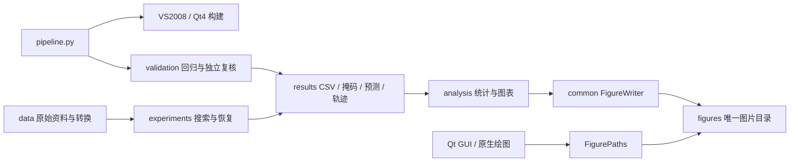

# 代码结构与执行关系

重构基线为 `c191e6c5`，初始工作区干净。本轮基线及图片哈希见
`results/refactor_20261024/baseline.json`，迁移映射见 `config/path_migrations.json`。

## 原生程序

活动源码统一放入 `src/native`。原 `IrrGeometryDesign` 中的计算、GUI、数据模型、
外部库、构建文件和资源现在各有明确位置。C++ 算法的公共类型及 GUI/CLI 入口继续保留。

原 5,758 行实验引擎拆为数据/兼容入口、采样实验、几何属性、波场恢复、完整工作流、
坐标恢复、研究实验、查询接口及独立回归单元。`experiment_internal.h` 只声明这些单元共享的实现服务，
不成为 GUI 的新接口。原 `geometryexperimentengine.h` 继续提供应用层接口。
`adaptivesearch.inc` 是优化器内部实现，两个回归 `.inc` 是函数内测试片段。

原生科学算法不借目录重构调整参数或数学定义。结构检查逐字比较 16 个核心文件，
只允许包含路径和行尾变化；运行重放进一步检查搜索与恢复输出。
所有源码迁移保留原有中文编码，UTF-8 BOM 保持在文件起始位置。

VS2008 工程在 `build/legacy`，中间产物和 Qt 自动生成文件分别在 `build/obj`、`build/generated`。
两个根目录构建脚本共享 `build/native.bat`。`build/qt` 是同一活动源码清单的 Qt4 工程。
FFTW 导入库/DLL、FDCT 和 qcustomplot 位于 `third_party`；不对第三方实现做格式化重写。
已删除不被活动工程引用、还指向缺失文件的旧 Qt3 向导副本及过期生成工程元数据。

## Python 包

所有活动脚本改用 `research.*` 绝对导入，统一根路径由 `research.common.paths` 提供。
数据读取、实验执行、统计/绘图、验证和维护各有子包。路径、流式哈希、CSV 和原生环境
集中到 `common`，实验模块不再依赖测试运行器取得哈希函数。

`pipeline.py all` 是本地完整验证入口。正式大规模研究可单独通过模块入口运行，
输出必须使用新的研究目录；不会把新程序指纹与旧缓存混用。
`layout_smoke_v1` 是两例完整软件流水线检查，不是增加独立地质模型或真实来源。

## 图片和历史追溯

图像实体只允许出现在 `figures/`。当前生成格式统一为 PNG，源图标也位于该目录。
`FigureWriter` 为每次绘图建立共享登记，两个生产者写入相同图 ID 会立即失败。
批量原生实验通过 `IRR_DISABLE_FIGURES=1` 禁止反复绘图；原生保存统一通过 `FigurePaths`。
原生恢复新增实际迭代轨迹 CSV，便于后续从数据重绘。

去重以图的类型和实际输入哈希为准。旧 PNG 字节相同、输入 CSV 不同的情况按不同数据
重新绘制，不能把过期图片当成正确副本。旧测试图片和草稿被正式版替代；不同协议的真实
结果不拼成一个统计样本。历史恢复图缺少轨迹时重放原掩码，图中明确区分归档矩阵与当前重放轨迹。
缺失原矩阵的旧示例使用确定性重放，数据说明记录这一限制及与归档输出的差异。

冻结结果、原生命令和运行快照是历史资料，不属于活动源码树。它们中的旧路径保留事实含义。
历史验证显式选择原运行程序、原 Git 来源或完全匹配哈希的源文件快照；科学 CSV、输入和预测
仍从工作树检查。Git 的 LF 与当时 Windows CRLF 不同时，只接受能精确匹配既有 SHA-256 的
行尾恢复，并在报告记录。它不代表允许对修改后的程序复用旧实验缓存。

## 验证边界

自动构建、回归、数值复核、预测重放、GUI 截图和链接检查各自记录实际结果。
打开窗口并截图不能代替所有 GUI 按钮的人工操作；x64 构建通过不能作为 Win32 或其他系统验证。
原资料编码/采集语义、第二独立真实来源和跨工区有效性，仍以既有数据报告中的未确认状态为准。
