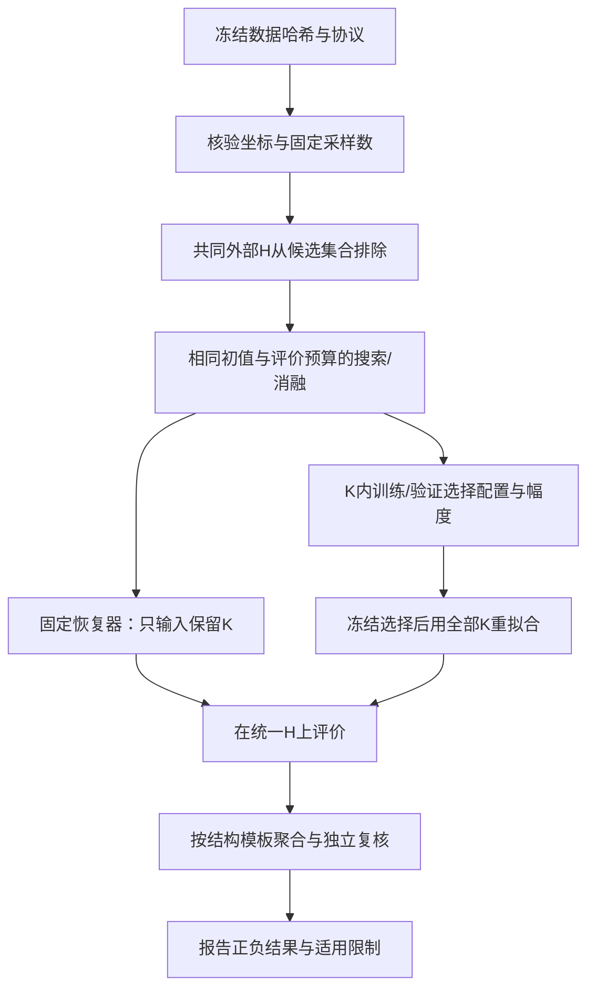

# 硕士论文方法、实验与讨论：adaptive_hybrid_v4

论文题目：《基于混合优化算法的地震采样点智能筛选方法研究》。本稿第1–8节对应冻结协议 `adaptive_hybrid_v4`，第9–10节补充本轮v5审查与勘误；此前 `physical_psf_v3` 数据保留于 `results/enhanced_20261023/`。原 v2 方法稿另存于 `docs/archive/THESIS_METHODS_classic_psf_v2_20261023.md`。

所有优势判断以实际配对结果与适用条件为准。SA、局部搜索和扰动重启均有已有方法基础；本项目研究的是针对地震候选点筛选的组合设计及其可验证效果，不将通用机制本身声称为首次提出。

<!-- add by wushanzhou in 2026/10/24 -->

## 1. 候选点筛选与目标

设候选位置为严格递增的 \(x_0,\ldots,x_{N-1}\)，采样掩码 \(\phi\in\{0,1\}^N\)，满足 \(\sum\phi_j=m\)。均匀网格取 \(m=\operatorname{round}(Nc)\)；128 点的 30%、50%、70% 档实际保留 38、64、90 点。实测资料分别保留 20、30、40 道，实际比例应报告为 20/59、30/59、40/59。

定义 \(L=N(x_{N-1}-x_0)/(N-1)\)，字典频率为 \(k/L\)，\(k=0,\ldots,N-1\)。单位范数字典列的最大非对角内积为

\[
\mu(\phi)=\max_{d=1,\ldots,N-1}\frac{1}{m}\left|\sum_{j:\phi_j=1}\exp\left[-2\pi i d(x_j-x_0)/L\right]\right|.
\]

均匀坐标时该定义与索引 Fourier/PSF 目标一致。不规则候选点全保留时字典列仍可能非正交，不能要求 μ=0。上述频带是一项明确的建模选择，不能等同于真实地震波数谱的唯一正确频带。候选位置二值筛选也不等于连续自由布点。

设保留坐标为 \(z_1<\cdots<z_m\)。最大间隔包含两端边界；最近邻距离取各点左右相邻距离的较小值，端点使用唯一相邻点，再计算总体标准差与均值之比 \(CV_{NN}\)。软目标为

\[
J=\mu+\lambda_g\max\{0,g_{max}/(L/m)-1\}+\lambda_n CV_{NN}.
\]

新研究将两权重分别取 0、0.1、0.3，形成九组组合；零权重对应未加惩罚的 Adaptive。此前 v3 的同权重 0、0.1、0.3、1、3、10 扫描保留，但不是本轮新重构实验的全部配置。权重不依据外层测试 SNR 选择。

Fourier 互干度、最大间隔、最近邻均匀性与曲波恢复误差各有不同含义。最大间隔控制与局部稀疏变换恢复的联系已有研究基础，可参考 [Hennenfent 与 Herrmann 的抖动采样研究](https://slim.gatech.edu/Publications/Public/Journals/Geophysics/2008/hennenfent08GEOsdw/paper_html/paper.html)；本项目的模型、求解器和数据不与其无条件等同。

<!-- add by wushanzhou in 2026/10/24 -->

## 2. 自适应混合搜索

旧 Hybrid 使用含初值评价的 64 次 SA 前缀，随后执行按索引扫描的 ±1 贪心局部搜索；一旦局部停止就结束。这会限制邻域，并闲置总预算中的剩余部分。新算法保留相同的二值交换表示、评价目标和历史最优记录，采用以下机制。

1. **停滞触发切换。** 每个全局阶段至少执行 32 次 SA 候选评价；当历史最优连续 12 次未改善时，转入局部阶段。
2. **混合交换邻域。** 局部阶段交替使用对称方向的最近空位移动和全范围点交换，只有目标改善时更新精英解。每个完整候选目标计算都占用预算，不进行免费的候选目标预筛选。新方法把目标下降超过 1e-8 作为精英改善判据。
3. **停滞后的预算回收。** 局部阶段连续 12 次未改善后，保留精英解，并把剩余预算返回全局阶段；以计入预算的至多两对点交换尝试离开当前区域。
4. **全程温度日程。** 设总评价上限为 B，第 e 次评价使用 \(T=0.1\times10^{-4(e-2)/\max(1,B-2)}\)。扰动时采用不小于 \(0.01(1-p)\) 的温度，其中 p 为已消耗预算比例；接受概率仍为 Metropolis 形式。

初值评价计为一次。不可行候选先做廉价的几何检查，未计算 μ 时不计为目标评价；实际评价次数、终止原因、候选／当前值与历史最优轨迹分别归档。所有交换保持精确保留数。

均匀候选点使用 FFT 评分，避免直接求和的额外开销；不规则物理坐标计算后端预计算 \(\exp(-2\pi i d(x_j-x_0)/L)\) 原子，避免每个物理候选重复调用三角函数。缓存构造时间计入运行时间；它是计算优化，不另作为搜索机制效果。新后端仍逐候选计算完整目标。

消融包括 `FixedSwitch`（每全局阶段固定 64 次 SA 候选后切换）、`NoRecycle`（局部停滞即结束）、`AdjacentOnly`（局部仅 ±1）以及 `SA_Budget`（关闭局部搜索，保留同温度日程及后端）。FixedSwitch 与历史 Hybrid 的局部邻域和预算回收不同，不能混用名称。

迭代局部搜索中的扰动、局部改进与接受机制已有文献基础，见 [Lourenço、Martin、Stützle](https://arxiv.org/abs/math/0102188)。本项目的创新表述限于针对该采样任务的机制组合、预算管理及对应实证，不声称提出全新的通用元启发式。

<!-- add by wushanzhou in 2026/10/24 -->

## 3. 米制硬间隔

物理硬约束要求保留点间及左右边界的间隔均不超过 G。简单条件 \((m+1)G\ge x_{N-1}-x_0\) 只是必要条件；候选位置中的空洞也可能导致不可行。

以有序候选点构建动态规划：当 \(x_j-x_0\le G\) 时，状态 \(F(1,j)\) 可行；对 k>1，若存在 i<j，使 \(F(k-1,i)\) 可行且 \(x_j-x_i\le G\)，则 \(F(k,j)\) 可行。最终还要求 \(x_{N-1}-x_j\le G\)，回溯得到恰好 m 个点的初值。交换候选违反上限时拒绝。

正式 HardGap 对照在物理坐标下取 G=max(候选最大相邻间距,2L/m)，在均匀网格取 ceil(2N/m)。这与 v3 更严格的 ceil(N/m) 配置不同，不能混同。若共同 Jitter 初值不满足硬约束，先用动态规划构造可行初值。

这使物理硬约束的可行性与候选坐标本身一致。代码用小规模穷举、坐标平移与单位缩放进行验证。当前只实现一维最大间隔，没有把索引硬上限混作米制上限。

<!-- add by wushanzhou in 2026/10/24 -->

## 4. 重构及实际坐标投影

使用 [FDCT wrapping](https://curvelet.org/papers/FDCT.pdf) 进行二维曲波分解，保留最粗尺度，对其他系数使用 Wiener 型非线性收缩：

\[
\widetilde c=c\frac{|c|^2}{|c|^2+\lambda_s^2}.
\]

默认四尺度、16 个粗尺度方向、最高频小波、40 次迭代；阈值从 0.0265 余弦衰减至 0.0005，最高频阈值加倍。该迭代不直接具有经典凸 POCS 的全局收敛保证。

在均匀工作网格上表示 u，实际坐标的线性观测算子为 A，数据投影为

\[
u\leftarrow u+A_K^T(A_KA_K^T)^{-1}(d_K-A_Ku).
\]

网格间距不大于候选坐标的最小间距，观测 Gram 可按三对角系统求解。幅度尺度、观测和初始化只使用已知集合 K；最终恢复原输入单位。已知道一致性误差与隐藏道恢复误差分别报告。

<!-- add by wushanzhou in 2026/10/24 -->

## 5. 真实资料内层验证与信息隔离

唯一真实资料含 59 道和五个 CDP。二进制头及各道头均为 8 ms，原始 250 点覆盖 0～1.992 s；既有主输入时间重采样为 4 ms，并使用 0～1.020 s。读取器的 IEEE-LE 配置与文件格式声明存在冲突，必须披露，不以测试 SNR 决定解码配置。

每个外层划分先固定保留集合 K 和测试集合 H。仅从 K 中随机抽取约三分之一作为内部验证 V，其余作为训练 T。所有候选重构仅输入 T；候选池、种子、迭代次数和阈值方案预先固定。候选包括零预测、线性插值，以及 11 组曲波配置，覆盖冷／热启动、20／40／80 次迭代、阈值强弱／恒定／零收缩、三／四尺度和 8／16 方向。

对每个内部验证预测 p，估计

\[
\alpha=\operatorname{clip}_{[0,1]}\frac{\langle p,d_V\rangle}{\langle p,p\rangle},
\]

并按验证均方误差选择配置与 α。分母为零时 α=0；相同验证误差时按预设顺序选择较简单模型。选定后使用全部 K 重拟合，只对未知位置应用该幅度系数，已知道保持原观测；随后才评价 H。

零预测或很小的幅度系数可能被选中，这表示当前数据上的可预测性有限，不能把它包装为高质量曲波恢复。恢复器层的外层测试道不会参与参数、幅度标定、初始化、停止条件或配置选择。既有测试将预处理后的全部外层隐藏值改为原值的 13 倍加 7，检查所选配置、系数和预测是否仍不变；这不能单独证明原始数据预处理层隔离，见下文第9节的再审查勘误。

真实 SNR 只在隐藏实测道上计算：

\[
\mathrm{SNR}_H=10\log_{10}\frac{\sum_{t,j\in H}d_{tj}^2}{\sum_{t,j\in H}(\widehat d_{tj}-d_{tj})^2}.
\]

零填充基线为 0 dB，负值不截断。全幅 SNR、观测一致性和隐藏道精度不能互相替代。

<!-- add by wushanzhou in 2026/10/24 -->

## 6. 实验与统计

同目标优化方法采用相同 Jitter 初值、种子、采样数和 200／600 次评价上限，分别在 128 点均匀候选与 59 个实际 offset 上进行，每档 20 种子。Regular、Random、Jitter 为未优化采样基线；SA-only、Local、原 Hybrid、Restart 和新机制对照完整保留。规则采样重复种子不形成独立掩码。

空间权重以独立的 gap／NN 组合研究，并报告几何未支配关系。重构研究使用三个反射事件家族的六个独立参数／噪声实现，主要方法各五个掩码种子，权重扩展各三个。它们是解析反射事件模型，不是六个真实工区或复杂地下波动方程正演。

同目标 μ 的主比较为 Adaptive 对 Hybrid、SAOnly、SA_Budget、FixedSwitch、NoRecycle、AdjacentOnly，跨两域、两预算、三档，统一构成 72 项 Holm 校正族。空间惩罚优化的是不同 J，不加入同目标优越性排名。

另将各对方法截取到同一配对中较小的实际评价次数，描述同次数下的质量差异，以区分继续使用剩余预算与前段搜索效率；这部分为补充描述。合成 SNR 使用每个模型实现的多掩码均值做模型层配对，而不把同一模型的所有掩码当成独立地质实现。真实随机划分上的检验只解释这一固定来源的条件性变化。

Wilcoxon 检验保留并列中秩，使用精确符号置换分布，并报告配对秩二列效应量。其差值分布对称性及有限模型数量限制应在正文说明。相关性与多元回归只作分组、去重后的描述性分析，不作因果解释，也不用于选择外层测试参数。

<!-- add by wushanzhou in 2026/10/24 -->

## 7. 结果与可用创新表述

最新实际结果、校正统计及反例分别见 `results/review_20261024_v4/final/RESULTS.md`、`summary.json` 和 `docs/REVIEW_REPORT_20261024.md`。原 v3 结论继续作为历史基线，不与新模型或新重构流程的 SNR 直接相减。

最终批次中，新 Adaptive 在 12 个搜索组的最终 μ 均值均低于旧 Hybrid，统一 72 项 Holm 校正后有 6 组显著；对 SA-only 未显著。截取到共同实际评价次数后，对 NoRecycle 的差异消失，表明剩余预算利用是当前证据最明确的改善。六个合成实现未支持新方法普遍提高重构 SNR，低／中采样平均 SNR 还低于旧 Hybrid。

同一真实来源、相同外层随机掩码下，保留 20／30／40 道的固定默认恢复平均 SNR 为 −1.2182／−0.9233／−0.6782 dB；保留道内配置选择及幅度正则化后为 +0.2151／+0.3538／+0.6275 dB。这是恢复流程的条件性改善，不能归功于采样优化，也不证明高保真事件或成像恢复。分 CDP 仍有负值、近零或零预测的结果。

可按证据讨论三类贡献：针对固定点数筛选的停滞切换与预算回收混合机制；实际坐标字典、空间覆盖惩罚与米制可行性的一致建模；采样目标—覆盖属性—恢复质量的端到端独立验证及真实失败诊断。各机制是否具有独立优势，应由消融决定，不能仅因组合方法改善而全部归功于每个部件。

不主张 Hybrid 普遍最优、低 μ 保证曲波恢复更好、单一真实来源代表跨工区推广，或当前几何结果已经证明成像质量改善。当前代码与实验材料也不等于完整论文及文献论证均已完成。

<!-- add by wushanzhou in 2026/10/24 -->

## 8. 全记录与误差来源的补充诊断

在同一原始资料上另构造 499×59 输入，保持 4 ms 时间步长并覆盖完整 0～1.992 s，不做空间插值，也不填造末尾时间样点。其前 256 点与既有裁窗输入的差异仅为文本落盘精度。使用与主实验前两个种子相同的外层掩码，保留 20／30／40 道，共六个配对几何划分；在每个窗口内部独立执行既定内层验证。

不同时间窗具有不同参考能量及评价目标，跨窗口 SNR 差不能当作同一测试目标上的算法增益。全部记录仍来自一个真实来源。

真实诊断还在固定训练道子集上计算零时差相关性、±48 ms 有界时差相关性和频谱；有界搜索的相关性最大值只作描述，不据此宣称确定了 NMO 速度或失败原因。测试输出另按误差能量分解，区分预测能量、与真实隐藏道的交叉项和边缘外推所占误差。该诊断不反馈参数选择。

真实结果同时报告固定 POCS、仅加验证幅度系数、选中配置在系数缩放前的输出及最终输出。后者是输出分解，不是另行用测试集挑选的“参数单独最优算法”。不能把幅度收缩带来的均方误差降低全部归功于采样优化，也不能由此推断振幅保真或成像质量改善。

<!-- add by wushanzhou in 2026/10/24 -->

## 9. 从 v4 到 v5 的再审查、勘误及补充验证

本节补记基线 `72240bbf` 之后的实际工作。v4/final 原始结果及本稿前述 v4 数字保持历史含义；
新实验是 `audit_joint_v5`，位于 `results/audit_20261024_v5/`。详见
[数据验证](DATA_VALIDATION_REPORT.md)、[算法审查](ALGORITHM_REVIEW.md)、
[协议](EXPERIMENT_PROTOCOL.md)、[统计单位附录](EXPERIMENT_PROTOCOL_STRUCTURAL_ADDENDUM.md)、
[实际结果](EXPERIMENT_RESULTS.md)及[验证](VALIDATION_REPORT.md)。

问题范围需写清：实验保留的是一维候选位置上的整道，固定基数是道数，时间样点不是额外
独立横向采样位置。GUI 中的二维/三维几何功能不等于已验证二维/三维采样算法的普适恢复性能。

**资料来源的新增证据。** 全部59道的250样点/8ms与完整字节布局一致，但文本头2ms、
随附PDF的单炮/道距/距离、15个source-point及五个CDP之间存在矛盾；坐标差与offset恰相差100。
因此当前IEEE-LE与头offset仍只是显式、可复现而未被来源方证实的解释。
禁止把既有归一化CSV、插值128道参考场或多个CDP称为独立真实来源。

**预处理隔离勘误。** v4恢复器的已知道归一化和内层选择测试通过，但此前59道CSV在划分前
用了全场峰值，接触过隐藏幅度。线性尺度在理想运算中可抵消；实际6位CSV舍入干预仍产生
约0.00748原幅度单位的预测差（原峰值7155，预测差约为原峰值的1.05e−6），不能称作严格的原始数据隔离。
v5取消全场预归一化，不做空间插值/数据拟合滤波；每次原生调用前将未观测列置零，
只按当次训练道定尺度。完整原幅度干预的配置和预测均完全不变。

**一致性判据修复。** 原幅度输入暴露出反归一化后仍按绝对1e−5判断投影的单位相关失败；
现按已知道尺度判定。独立稠密投影误差约6.0e−8；纯FDCT的20种复数组组合在两构建下
正反相对误差约1e−15。修复没有改变阈值或用外层SNR选参数，也不能解释旧归一化实验的负值。

**共同 H 的采样—恢复对照。** 统一H含16列，搜索只能在其余112列选m=38/64/90，
Fourier字典仍用完整128列坐标。另保留传统掩码补集评价。固定默认曲波与K内选择
（零/线性/默认/cold及幅度系数）各自报告，不能把选后提高归功采样。
共12个结构/噪声条件×3采样档×3掩码×5方法×2设计=1080条记录。

**统计依赖性。** 12条件只有6个不同干净结构模板；先按模板平均两噪声条件再推断。
初版12条件中出现的8个校正显著项保留，但模板层24项Holm全部未显著，最小调整p=.75。
这项依赖性复核是在读过初版结果后作出的更保守修正，不能写成完全预注册的确认性检验。
两个分析版本均保存，未按有利结果选择统计口径。

**机制与效率。** 新搜索敏感性B=300、10种子、7组窗口/最短SA设置；没有建立普适SA-only优势。
共同实际评价前缀上，Adaptive与NoRecycle的差为0，预算继续利用的解释比独立机制提升更强。
30ms顺序QPC对照记录了实际评价和实际时间，但温度仍按评价比例，不能当作完全匹配降温的
等时间优势。当前保留v4入口，NoPerturb只是消融，未因描述性均值替换主算法。

**恢复与失败讨论。** 原幅度24个真实窗口案例中，固定默认17个负SNR，内选后仍有1个负值。
预设案例图展示振幅/波形失配，能量分解解释误差如何形成，不能独自识别物理原因。
时间像素尺度、事件连续性、外推、不同CDP、收缩先验和编码冲突仍有待区分。
NMO/时差校正没有无依据加入；需要明确采集几何和训练道内可识别的速度信息。

## 10. 论文写作材料的对应关系

|论文章节/内容|当前材料|完成边界|
|---|---|---|
|问题建模、目标推导、固定基数、边界/硬约束|本稿1/3节及ALGORITHM_REVIEW|一维道级候选，已独立数值核验|
|混合算法、伪代码、流程、复杂度|本稿2节及ALGORITHM_REVIEW第3–6节|不把通用机制写成全新理论|
|曲波原理、初始化、收缩、投影、停止|本稿4/5节及纯变换/稠密投影记录|数值收敛不等于隐藏准确性|
|数据集、预处理与来源审计|DATA_VALIDATION_REPORT|真实编码/几何未确认|
|对照、消融、预算、敏感性、统计|EXPERIMENT_PROTOCOL及结构模板附录|探索性与确认性分清，统计样本不扩大|
|合成/真实恢复、失败和负结果|EXPERIMENT_RESULTS及原生CSV|单真实来源；共同H和补集分开|
|收敛、效率、权重/Pareto及论文图|`figures/research/v5/`及各图data.json|当前集中保存10组PNG；CI单位、种子/模板数明确；历史SVG由Git保存|
|创新点、局限与未来工作|THESIS_CONTRIBUTIONS、UNRESOLVED_ISSUES|没有普适最优/真实高保真/跨工区结论|

可用流程图（论文排版时可按此导出矢量图）：

本页已有可写入方法/实验/讨论的材料，不代表研究综述、学校格式、导师审阅及独立工区验证已经完成。
